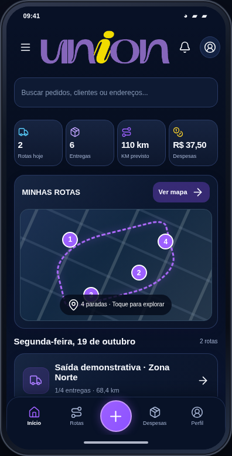
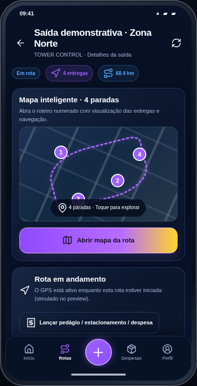
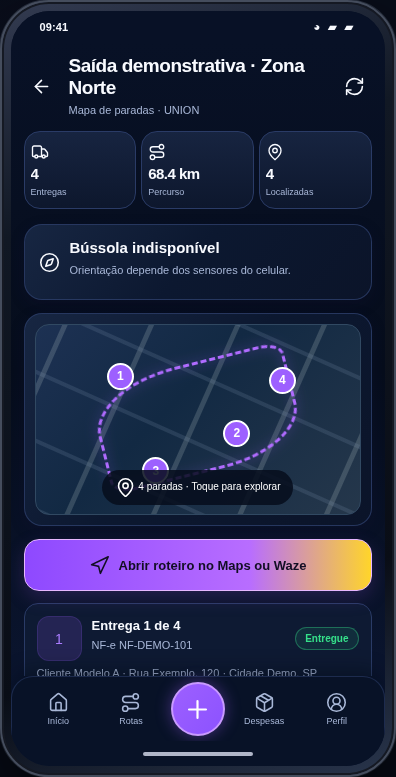
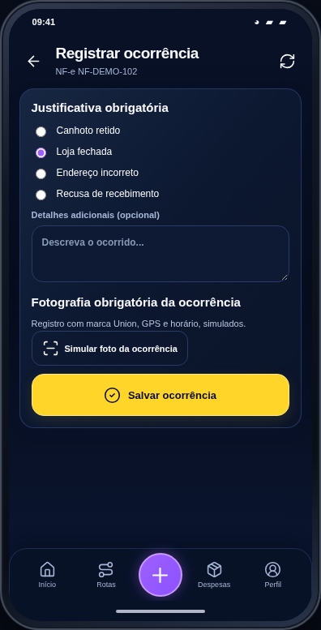
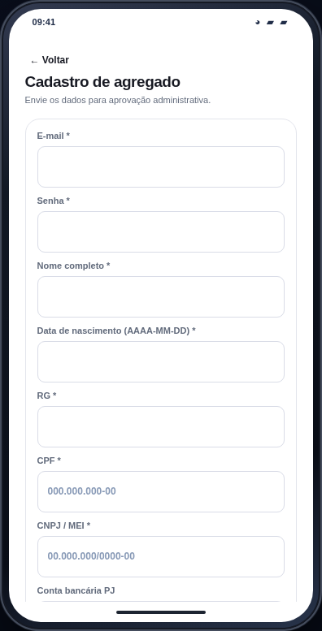

# UNION Agregados · Preview do Android Kotlin (versão 3)

**[ABRIR O APP EM UM CELULAR VIRTUAL INTERATIVO](https://ronilima1810.github.io/formulario-de-matricula/portfolio-demos/android/)**

A versão 3 substitui o simulador visual genérico anterior. O resultado foi construído por comparação com os arquivos **reais do aplicativo nativo** no repositório privado [FleetOps](https://github.com/Ronilima1810/fleetops-gestao-frota/tree/main/android/app/src/main/java/online/lumustech/agregados/ui).

## Screenshots da demonstração

| Login | Início | Detalhes da rota |
|:---:|:---:|:---:|
|  |  |  |

| Mapa | Ocorrência | Cadastro |
|:---:|:---:|:---:|
|  |  |  |

## Paridade com o código Kotlin

| Kotlin original | Preview do navegador | Status |
|---|---|---|
| `ModernLogin.kt` | Login branco, logo UNION, vídeo MP4 original 16:9, e-mail/senha, recuperação, cadastro | Visual replicado, login fictício |
| `TechDesign.kt` e `Theme.kt` | Paleta TechBg `#060D1C`, TechCardBg `#0E1A33`, TechPurple `#9D60FF`, TechYellow `#FFD52A`, tipografia, cards/raios | Reproduzido em CSS |
| `TechIcons.kt` + `res/drawable` | 47 símbolos vetoriais extraídos dos desenhos de ícones Android | Mesmos vetores |
| `ModernShell.kt` | Logo centralizada, botão menu, gaveta lateral, notificações, navegação inferior 65dp, botão `+` de 54dp | Layout e ações demonstrativas |
| `ModernHome.kt` | Busca, quatro métricas, miniatura de mapa, rotas, andamento | Dados/rota fictícios |
| `ModernNewRoute.kt` | Romaneios com filial por linha, chaves NF-e, revisão e geração local | Sem API NF-e |
| `RouteDetailScreen.kt` | Detalhe, paradas, status, início/finalização, edição de endereço, comprovante, fachada, vídeo, ocorrência, despesa | Sem câmera/GPS/upload real |
| `RouteMapScreen.kt` e `NativeOsmMapView.kt` | Paradas numeradas e mapa esquemático | Não executa motor nativo OSM, Google Maps ou Waze |
| `RouteHistoryScreen.kt` | Pesquisa e histórico de saídas concluídas | Fictício |
| `Screens.kt` | Cadastro com RG, CPF, CNPJ, dados bancários, veículo, CNH e selfie simuladas; recuperar senha; aprovação | Formulários demonstrativos |
| `SignatureCapture.kt` | Assinatura com toque ou mouse em Canvas | Apenas memória da página |
| `FacadePhotoStamp.kt` | Marca UNION com horário local, NF-e e GPS explicitamente fictício | Carimbo ilustrativo, não é arquivo de câmera |
| `AppUpdater.kt` | Tela de atualização com aviso de versão | APK real não é instalado por navegador |

## Testes executados

- Sintaxe do código JavaScript e carregamento isolado de HTML/CSS/logo/vídeo/ícones.
- **16 telas** navegadas por Chromium headless, verificando a existência de conteúdo, navegação e o tema do login.
- **15 verificações funcionais encadeadas**: login, menu, criação por romaneio com revisão, rota, canhoto, confirmação, ocorrência com foto fictícia, despesa, assinatura, cadastro e aprovação.
- Nenhum erro JavaScript no teste final. A validação GitHub Actions de integridade de fontes, paleta e telas é feita pelo workflow `Verify Portfolio Previews`.

## Limite importante — fidelidade

O preview procura reproduzir o tema e a navegação usando os **mesmos arquivos de logotipo, vídeo e vetores, além de dimensões, cores e textos identificados no Kotlin**, mas é um **simulador web**. Não executa o framework Jetpack Compose e **não é uma cópia 100% pixel a pixel de todas as telas nativas**. Partes como câmera, prova fotográfica, mapa OSM, reconhecimento de GPS, uploads, notificações push e autenticação permanecem ilustrativas ou desabilitadas. Nenhum dado empresarial, API da VPS ou segredo é utilizado.

**Para observar o layout nativo exato em execução, instale a compilação Android e use um aparelho ou emulador real:** [workflow do APK](https://github.com/Ronilima1810/fleetops-gestao-frota/actions/workflows/build-android.yml). Esta página permite testar a navegação sem instalar Android.
