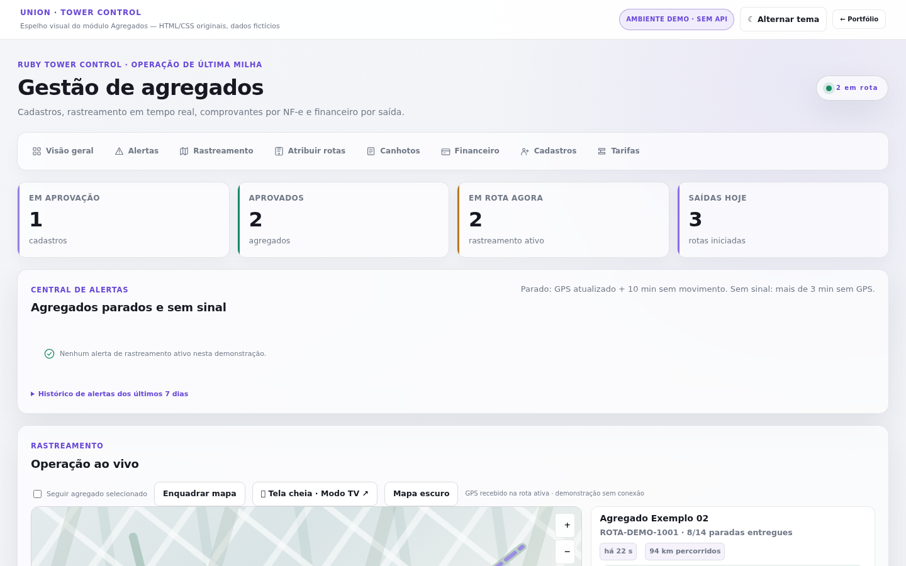
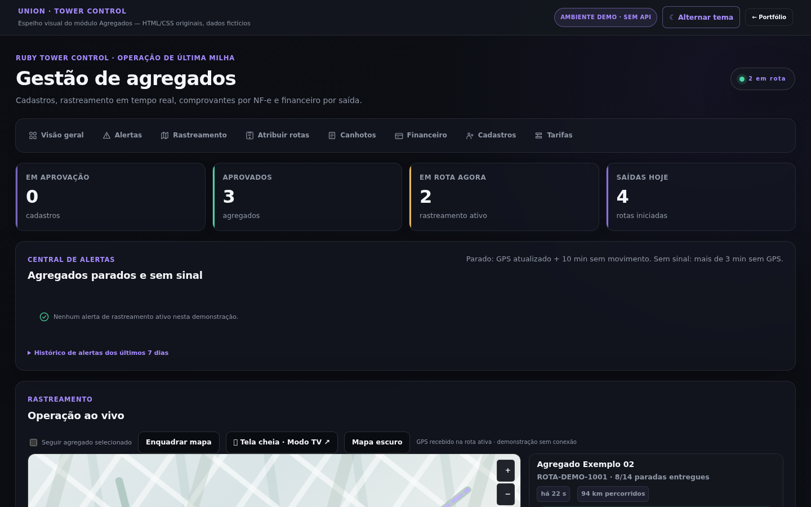

# FleetOps · Administração de Agregados — preview do frontend original

**[ABRIR O PAINEL REVISADO](https://ronilima1810.github.io/formulario-de-matricula/portfolio-demos/fleet/)**

O preview anterior utilizava `../system/app.js` e `../system/styles.css`, compartilhados com outros projetos. **Esse frontend era uma reconstrução genérica e não representava a página real de Agregados.**

Esta revisão se baseia no módulo **`/var/www/html/ruby/agregados/index.php`** da VPS, que também está versionado no repositório privado `fleetops-gestao-frota/agregados/index.php`. As classes e seções HTML seguem o padrão original da aplicação, com os CSS de produção em `native/`:

- `ruby-theme.css`
- `agregados.css`
- `financeiro_admin.css`
- `ruby_admin_standard.css`
- `admin_legibilidade_0322.css`
- `admin_dispatch_0321.css`

O `fleet-original.css` somente implementa elementos ilustrativos que não podem funcionar sem backend (por exemplo, mapa com trajetos artificiais). O `fleet-original.js` reproduz os controles do painel com dados **inteiramente fictícios** e operações locais.

## Interface corrigida

## Cobertura de painéis

| Área real no PHP | Preview |
|---|---|
| Visão geral | Os mesmos quatro KPIs e navegação interna |
| Alertas | Estado de rastreamento e histórico fictício |
| Operação ao vivo | Layout de mapa/lista original, posições de demonstração sem GPS |
| Atribuir rotas | Agregado, filial por romaneio, inclusão de linhas e atribuição simulada |
| Canhotos | Pesquisa por NF-e com comprovante fictício; nenhuma foto real |
| Financeiro por saída | Consolidado por agregado, tabela de saídas e aprovação local de valores |
| Cadastros | Em aprovação, aprovados, reprovados; cadastro fictício com documentos mascarados |
| Tarifas e negociação individual | Valor por saída, KM incluídos, KM excedentes, ajudante e reembolsos |

## Limites técnicos

Este preview **não executa PHP nem JavaScript real do backend**, não autentica usuários, não busca documentos, não envia localização e não se comunica com a VPS. Os CSS são originais, e a estrutura da página foi reconstruída a partir das mesmas seções e classes do código-fonte original. O mapa é propositalmente **ilustrativo**, sem reproduzir Leaflet/MapLibre e suas rotas reais.

Assim, a versão é visualmente muito mais próxima do sistema Ruby do que a demonstração anterior, mas não é uma instalação funcional ou uma captura pixel a pixel de todas as respostas dinâmicas. O aplicativo Android tem [preview específico](../android/).

## Verificação

Em Chromium headless, os oito painéis da administração foram encontrados (mais os quatro KPIs), com todas as sete folhas de estilo carregadas. Foram exercitados filtros, aprovação fictícia, atribuição de romaneio, tabela financeira e tema escuro. Nenhuma exceção JavaScript ou requisição a recurso inexistente foi identificada no teste final. O workflow `Verify Portfolio Previews` verifica sintaxe, caminhos e integridade da versão pública.

Nenhum arquivo da aplicação hospedada foi modificado.
