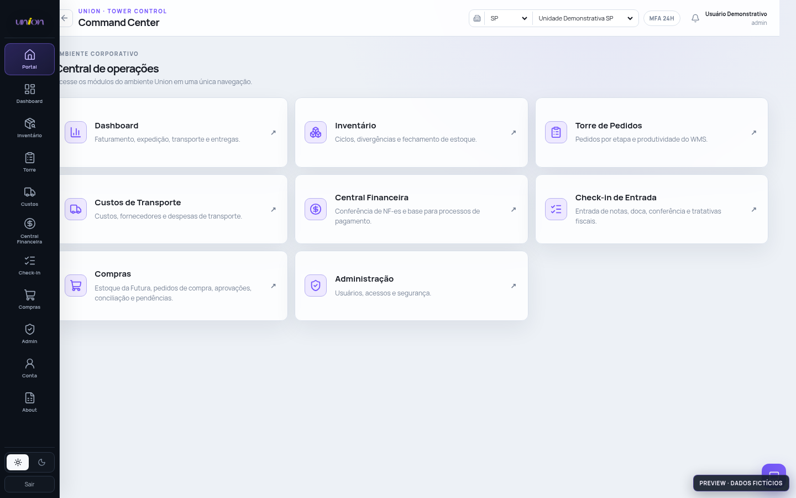

# Ruby Tower Control — preview fiel da interface hospedada

A tela principal é renderizada pelo **mesmo bundle React, CSS de tema e CSS responsivo implantados em /ruby/workspace/**, extraídos dos arquivos originais autorizados na VPS.

O adaptador mock-api.js substitui a resposta de bootstrap por usuário, unidades e módulos fictícios. Ele impede requisições a APIs da produção. Não são enviados banco de dados, chaves, tokens ou dados operacionais.

**Escopo da fidelidade:** shell, cabeçalho, menu, cards e rotas React do workspace original. As telas PHP legadas são **simulações estáticas navegáveis**, com o CSS original compartilhado, tabelas e indicadores fictícios; elas não executam o PHP de produção nem reproduzem integralmente o layout/fluxo operacional original de cada módulo. O aplicativo Android continua em um preview separado.

Este código foi publicado para comparação visual. A versão pública é uma demonstração, não o sistema Ruby funcional nem uma reprodução homologada de cada tela.

## Captura da tela original em execução

## Cobertura dos módulos demonstrativos

**[Abrir todos os módulos no Command Center](https://ronilima1810.github.io/formulario-de-matricula/portfolio-demos/ruby-original/#/portal)**

| Área | Visões demonstrativas |
|---|---|
| Dashboard BI | Dashboard, Expedição, Gargalos, Transporte, Financeiro e Governança (rotas React originais, indicadores sintéticos) |
| Inventário | 16 visões incluindo Resumo, Executivo, Pendentes, Divergências, Endereços, Fechamento, Monitor e Dev log |
| Torre de Pedidos | Pedidos, Produtividade, Ocorrências, Funil |
| Transporte | Visão operacional e Fornecedores |
| Central Financeira | Geral, NF-es, Agregados, Contas a pagar, Consolidado |
| Agregados | Cadastros, Rotas, Tracking ilustrativo, Comprovantes, Ocorrências, Financeiro e Negociação por KM |
| Check-in | Fila, Não conformidades, Armazenagem, Configurações |
| Compras | 15 áreas, incluindo Início, Estoque, Pedidos, Aprovações, Indicadores, Fiscal, Matriz e Processos |
| DANFE MG | Chave de NF-e, Romaneio e Histórico, com impressão apenas simulada |
| Admin | Usuários, Acessos, Equipes, Novo acesso e Configurações |
| Conta | Perfil, Senha (desabilitada) e Acessos |
| About | Sobre, Livro de processos, Tecnologias, Segurança e Criadores |

**Testado em Chromium:** 19 rotas de portal/visões PHP com conteúdo demonstrativo, além das seis visões React de BI; sem erros JavaScript na área testada. O teste automático de integridade dos arquivos é executado no GitHub Actions.

A ferramenta `module-demo.js` é um simulador; filtros, exportação CSV, cálculo de adicional por quilômetro e emissão fictícia de etiquetas operam somente no navegador. Os dados nunca são enviados a servidores empresariais.
